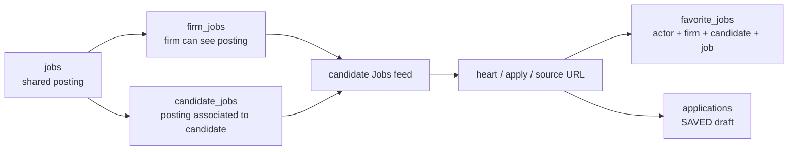

# Implementation plan: PostgreSQL demo jobs to candidate application workflow

**Status:** Modules 1–4 implement the Jobs → Saved slice. The candidate Saved ↔ Applied implementation is now in place; runtime verification and owner review remain pending. Progress and evidence are tracked in [STATUS.md](./STATUS.md).

## Goal and scope

Implement one complete vertical slice in localhost:3000:

1. Put clearly labeled demo jobs in PostgreSQL.
2. Link each job to the correct firm and candidate so it appears in that candidate's Jobs feed.
3. Clicking the heart, “Tailor & apply,” or a source/application URL persists a candidate favorite in `favorite_jobs` and adds/ensures the job in Applications → Saved.
4. For apply/source URL clicks, save first and then open the external posting. Keep the job in the Jobs feed with the heart filled and show the Saved application after reload.

The localhost:3001 page is the visual/interaction reference only. Do not connect to 3001 as a service. Live job scraping, Inbox integration, browser-extension submission capture, email-based status changes, tailoring, and the rest of the candidate tabs are outside this plan. The user has now approved adding one status action, Saved → Applied, before Inbox work; all other status transitions remain deferred.

## Implementation now in place

- Seven synthetic jobs are defined in the idempotent development seed and linked to existing Adna in Adnan's firm. The latest seed invocation added four jobs and four firm/candidate links; final database readback is left to the user.
- Candidate-scoped `GET /api/jobs` returns only firm-visible jobs linked to the requested authorized candidate and includes canonical favorite IDs.
- Candidate-scoped application routes save and unheart through existing endpoints. Save writes the favorite and creates/returns a Saved application; unheart removes the favorite and deletes only an untouched Saved draft.
- Candidate Jobs and Applications/Saved read through live adapters. The candidate feed starts at Any score so demo jobs are visible without changing the general Jobs default. Heart, apply, and source URL actions ensure the job is Saved; apply/source actions then open the external posting. Saved does not count as an application submission, and later-stage moves remain disabled until the Applied workflow is implemented.
- No automated tests or final verification are claimed. See `STATUS.md` for what the user can verify next.

## Current slice: Saved ↔ Applied (implementation in place; verification pending)

### Goal and agreed behavior

An authorized signed-in BDE can move a Saved application to Applied on the Applications board. Pan viewing Adna is a test example, not a hardcoded actor or workflow restriction. This manual move is the user's authoritative confirmation that the job was applied to.

On a successful move:

1. The application status becomes `applied`; the server sets `applied_at` to the transition time.
2. The backend records the status transition and an activity-ledger entry with the authenticated BDE's user ID and timestamp. For this initial workflow, it also sets `submitted_by_user_id` to that BDE. Both IDs are derived from the signed-in session, never from a client-supplied ID. Revisit the field's meaning in a later phase as requested.
3. The matching `favorite_jobs` row is removed, so the heart is no longer filled.
4. The job is excluded from that candidate's Jobs feed. The application remains under Applications → Applied.
5. Each direction must commit atomically. On failure, status, favorite, activity history, date/submitter fields, and feed visibility remain as they were before the attempted move.

Saved → Applied and Applied → Saved are enabled in this slice. On the reverse move, record a new transition and keep prior history; clear the current `applied_at` and `submitted_by_user_id`, recreate the favorite for the BDE making the change, and restore the job to that candidate's Jobs feed. Keep these writes atomic. Do not enable RESPONSE, SCREENING, INTERVIEW, OFFER, PLACED, REJECTED, WITHDRAWN, EXPIRED, or arbitrary drag transitions. Later status work is deferred until Inbox integration is planned. The 3001 site remains a UI reference, not a service.

### Architecture findings before this slice

- Candidate Applications are read through the live candidate-scoped `listForCandidate` adapter in `src/lib/api/applications.ts`.
- Before this slice, the status mutation in that adapter called `applicationsMock.updateStatus`; it did not call the backend. Candidate board moves now use the live candidate-specific mutation; unrelated global application adapters remain unchanged. The new PATCH route is classified as firm-user access in `backend/auth/access.py`.
- `backend/api/routes_applications.py` already accepts `applied` in `VALID_STATUSES`, accepts `applied_at` in its update body, records a timestamp/source in `status_transitions`, and supports removal of a favorite through a separate `{unfavorite: true}` operation. The current status path does not combine status/favorite changes in one transaction, does not set or clear `applied_at` automatically for these moves, and does not write a ledger event for ordinary status changes. `saved` is not currently an allowed application status target.
- `backend/auth/ledger.py` and the existing `ledger_entries` table already support recording an authenticated actor, event time, firm, and candidate. Team rules say to write through this helper and not change the ledger table.
- `backend/api/routes_jobs.py::list_jobs` now excludes jobs with a non-Saved application for the requested candidate and excludes those IDs from the returned favorite list.
- `applications` already has `status`, nullable `applied_at`, `candidate_id`, and JSON `status_transitions`; `favorite_jobs` already links firm, candidate, job, and marking user. No new table/column or migration is currently indicated for the agreed flow.
- Team ownership assigns `applications` and `favorite_jobs` write routes to Samad, and `jobs`/candidate feed routes to Zuhair. The Jobs table seed and candidate-scoped `GET /api/jobs?candidate_id=...` feed are already implemented in Modules 1–2; Module 6 must only extend that existing query with Applied/Saved visibility behavior, not seed more jobs or build a new feed route. Coordinate that narrow route change with its owner and obtain Abdul's required code-owner review. If implementation reveals a real schema/contract change is required, stop for product-owner approval rather than inventing one.

### Module 6 — Candidate Saved → Applied

**Objective:** Replace the candidate board's mock status mutation with backend-backed Saved ↔ Applied transitions that update the application, synchronize its favorite and candidate feed visibility, and write audit activity.

**Files expected to change (confirm against the diff before implementation):**

- `src/lib/api/applications.ts` — PATCH live update and DTO mapping; no mock fallback for this candidate workflow.
- `src/lib/hooks/use-applications.ts` — include the transition date/status in the mutation contract, maintain optimistic update/rollback, invalidate Applications and candidate Jobs/favorite queries.
- `src/lib/api/dto/applications.ts` — map any required response event fields; keep backend shapes inside DTOs.
- `src/components/app/applications/application-board.tsx` and `src/components/app/candidate/applications/applications-tab.tsx` — permit only Saved ↔ Applied in the candidate board; do not unlock other board transitions.
- `backend/api/routes_applications.py` — in one transaction, authorize the actor, support only Saved ↔ Applied, set or clear the current applied fields, create/delete the matching favorite, and write activity through `backend/auth/ledger.py`. Keep idempotency and scope checks.
- `backend/api/routes_jobs.py` — exclude jobs from a candidate feed when that candidate has an application progressed beyond Saved; preserve other candidates' visibility and current firm/candidate scoping.
- Relevant existing tests under `backend/tests/`, plus frontend tests colocated with the API/board if present.
- `docs/integration/STATUS.md` — update task status and evidence in the same session as every implementation change.

**Phase 6.1 — Owner and behavior sign-off**

- Confirm with Samad before changing Applications/favorite write behavior, and coordinate with Zuhair only for the Applied/Saved filter in the already implemented candidate feed endpoint. Do not redo job seeding or feed integration. Obtain Abdul's required route/code-owner review. No database migration is planned; if a column/table/contract change becomes necessary, stop and request approval.
- Resolved: record whichever authorized firm user makes the status change in the activity ledger and set `submitted_by_user_id` to that authenticated actor for now. The existing `application.move` policy permits OWNER, MANAGER, and BDE; Pan is only the example user. Revisit this field's semantics in a future phase.
- Resolved: allow Applied → Saved as a recorded reverse transition. Restore the favorite and feed visibility, clear current applied date/submitter fields, and preserve earlier status/ledger history.

**Progress:** user decisions are recorded and implementation proceeded under the user's explicit instruction. Owner/code-owner review remains pending before merge; no table or contract change was introduced.

**Phase 6.2 — Backend atomic transition and feed behavior**

- Validate the application belongs to the authorized firm and candidate, and the actor can perform `job.apply`.
- Accept only Saved → Applied and Applied → Saved for this workflow. Saved → Applied sets `applied_at` from server time, sets `submitted_by_user_id` to the authenticated BDE for now, appends status history, removes the favorite, and writes a ledger event. Applied → Saved clears current applied date/submitter fields, appends status history, recreates the favorite for the authenticated BDE, and writes a ledger event.
- Commit status, date/submitter, favorite, history, and ledger writes together. A retry must not create duplicate events or corrupt the record. Reject unsupported status targets; preserve all prior history.
- Exclude progressed applications from the candidate Jobs feed and its favorite IDs. Keep the job available to other candidates/firms according to their own links and applications.

**Done when:** API and database tests demonstrate atomic success, correct actor/time, applied date, cleared favorite, hidden candidate feed row, unchanged visibility for another candidate, and no partial update on failure. No schema migration is needed unless investigation disproves the current model.

**Phase 6.3 — Frontend live mutation and constrained board move**

- Replace the candidate board's mock `updateStatus` path with the dedicated `PATCH /api/applications/{id}/candidate-status` endpoint through `http.ts` and the Applications DTO adapter. Keep the existing general status-update route unchanged.
- Restrict the candidate board to Saved ↔ Applied only. General board behavior and the other candidate statuses must not be accidentally enabled by a global `canMove=true` change.
- Optimistically synchronize status, applied date/submitter, favorite IDs, and candidate Jobs cache in both directions. On API failure, restore all affected caches and show an actionable error.
- On success, invalidate/refetch candidate Applications, candidate Jobs, and favorite state so backend response is authoritative.
- Do not mark Apply/source URL clicks as Applied; those continue to save/open only as already agreed.

**Done when:** the UI sends a live backend update, only Saved ↔ Applied moves are available, and all views converge on the server response after reload.

**Phase 6.4 — Verification and review**

- Unit-test the frontend status allowlist, DTO mapping, optimistic rollback, and cache invalidation.
- API-test authorized Saved → Applied and Applied → Saved, invalid source/target states, unauthorized/cross-firm requests, repeat requests, and missing favorite edge cases.
- Database-test that both directions update application status/date/submitter, favorite, status history, and ledger entry in one transaction and roll back together.
- Verify candidate feed exclusion on Applied and feed/favorite restoration on Saved; ensure an unrelated candidate can still see their own linked job.
- Manually verify as an authorized firm user (Pan/Adna is the BDE example): Saved → Applied clears the heart and removes the feed row; Applied → Saved restores both; both persist after refresh; other status drags remain blocked. The user has reported these manual checks passed, including a Manager moving in both directions.
- Record exact commands and results; do not claim checks that were not run. Require owner/code-owner review before merge.

**Done when:** all tests and manual acceptance checks pass, the review gates are met, and the tracker contains evidence for each completed task.

### Risks and mitigations

- **Partial writes:** status, favorite deletion, and ledger must share one database transaction; API failure must roll back all writes.
- **Accidental broader workflow:** the board's shared `NEXT_STATUS` includes later stages. Restrict transitions specifically for the candidate view; never enable all stages to get these two transitions working.
- **Feed reappearance:** server-side filtering is required, not just removing the row from a browser cache. Exclude progressed applications in the candidate feed and test after reload.
- **Other candidate/firm impact:** candidate feed filtering must be scoped by both firm and candidate; do not change shared job visibility globally.
- **Actor attribution:** derive the actor from the authenticated session and record that BDE in the ledger and `submitted_by_user_id` for this initial workflow. Do not hardcode Pan or accept a client-supplied actor ID. Revisit `submitted_by_user_id` semantics in a future phase.
- **Concurrency and retry:** lock or conditionally update the Saved application, and make favorite deletion/event writes idempotent.
- **Ownership/review gate:** Samad owns Applications/favorites routes; Zuhair owns jobs/feed routes; Abdul reviews route and contract changes. The user explicitly authorized implementation; obtain owner/code-owner review before merge.

### Scope and completion criteria for this slice

- Only Saved ↔ Applied is enabled.
- Saved → Applied writes server `applied_at`, current BDE in `submitted_by_user_id`, transition history, and actor/time ledger activity; removes the favorite and feed row.
- Applied → Saved clears current applied date/submitter, records another transition, restores the favorite and feed row, and retains earlier history.
- The application appears in the matching Applications column after reload.
- Other candidates and firms retain their own job visibility and favorite state.
- Other statuses, Inbox-driven updates, email matching, application-form capture, and browser extension behavior remain deferred.
- No schema change occurs without the required owner approval.

## Baseline code and database findings (before implementation began)

- The candidate Jobs page currently reads mock jobs through the frontend adapter. `useCandidateWorkspace` calls the general jobs hook without a candidate ID; the mock feed is firm-filtered, then filtered in the browser.
- The Jobs heart currently changes a browser mock `JobMark`; it does not call the backend `favorite_jobs` table and is not candidate-scoped.
- Applications → Saved reads separate mock application records. Hearting a job does not create an application in the current frontend.
- The inspected PostgreSQL `jobs`, `firm_jobs`, `candidate_jobs`, and `favorite_jobs` tables had no rows. The current candidate's firm had no matching frontend job fixtures.
- Models and migration 0007 define `candidate_jobs` and `favorite_jobs`, but this checkout has no production routes/writers for them. The legacy applications route does not implement the candidate Saved workflow.
- The data model is not one fully enforced chain: `firm_jobs`, `candidate_jobs`, and `favorite_jobs` point independently at some shared records. The backend must check that firm, candidate, job, and acting user are authorized together.
- Team ownership docs assign `jobs`, `firm_jobs`, and `candidate_jobs` to Zuhair; `favorite_jobs` and `applications` to Samad. Samad's current plan schedules Inbox first and Applications second; the user has confirmed this Jobs → Saved slice should be prioritized before Inbox. Coordinate owner-specific work and shared contract approvals before implementation.

Detailed read-only evidence and source references are in [candidate-jobs-workflow-plan.md](./candidate-jobs-workflow-plan.md). Team ownership and ordering are in [team README](../team/README.md), [Samad's plan](../team/samad.md), [Zuhair's plan](../team/zuhair.md), and [candidate-core contract](../team/00-candidate-core.md).

## Data relationship to implement

`jobs` stores the shared posting. `firm_jobs` grants firm visibility. `candidate_jobs` associates a posting with a candidate. In candidate context, the heart, Apply, and external URL actions create/ensure a `favorite_jobs` row whose `marked_by_user_id` is the user who clicked and whose `candidate_id` is the candidate whose list it is. The same operation creates/ensures the matching `SAVED` application. Apply/source actions open the employer posting only after the save succeeds. The job stays in the feed. A favorite is not itself an application, and a Saved application is not evidence of submission.

## Modules and completion goals

### Module 0 — Ownership, contract, and safe target

**Goal:** clear prerequisites before anyone writes code or seeds records.

**Steps:**

1. Confirm candidate-core migration 0007 is merged and applied to the intended development/test database; inspect current migration head and legacy candidate-less application rows read-only.
2. Record backend URL/proxy, active module flags, and the intended database without exposing secrets.
3. Use the existing candidate **Adna** in **Adnan's firm**; do not create a mock candidate. Read the candidate's firm and assigned BDE relationship before seeding. The read-only database check confirms an active BDE account named **Pan** is assigned to Adna in that same firm. Demo job content must be synthetic and clearly labeled; do not alter candidate data.
4. Agree candidate feed and favorite permissions for Owner, Manager, BDE, Viewer, and cross-firm requests.
5. Approve SAVED application contract: null submission time/submitter, optional resume, and no Applied count effect.
6. Define the server-side “untouched Saved draft” rule for unheart. Preserve any notes, resume work, progress, or history.
7. Schedule the Samad-owned `favorite_jobs`/Applications Saved slice before Inbox/Extension, as the user has confirmed this priority. Samad owns these writes; Abdul/core approval is required for shared contract changes.

**Done when:** target IDs, contracts, migration state, permissions, and table-owner schedule are recorded. The order is Jobs → Saved first, Inbox next. No production or real-candidate data is selected by assumption.

**Depends on:** none. **Owners:** product/core owner plus Samad and Zuhair for their tables.

### Module 1 — Seed demo jobs and candidate links in PostgreSQL

**Goal:** a small set of synthetic jobs exists in the database and is associated with Adna and Adnan's firm. The test session is the assigned BDE Pan, who opens the Jobs view in Adna's candidate page and can see and act on the jobs.

**Steps:**

1. Create deterministic demo job rows in the shared/main `jobs` table with clearly labeled titles/source and inert example URLs. Do not create a candidate row.
2. Link each job to Adnan's firm through `firm_jobs` and to candidate Adna through `candidate_jobs`.
3. Preserve global job deduplication; if a job already exists, reuse it and add only missing authorized links.
4. Do **not** insert `favorite_jobs` rows during seeding. On a heart action, set `favorite_jobs.job_id` to the seeded/shared `jobs.id`; the favorite represents a real user action. Also store the correct firm, candidate, and `marked_by_user_id`.
5. Make the seed idempotent and limited to its own fixture IDs. Never reset, truncate, or rewrite unrelated database rows.

**Done when:** database inspection shows the expected jobs linked to the existing development candidate and its firm; rerunning the seed creates no duplicates and changes no unrelated rows. A later heart action references the same canonical `jobs.id` in `favorite_jobs.job_id`.

**Depends on:** Module 0. **Owners:** Zuhair for job/link tables; assigned integrator for seed tooling.

### Module 2 — Candidate-scoped feed API

**Goal:** the backend returns only jobs available to the requested candidate in the signed-in user's authorized firm/team scope.

**Steps:**

1. Extend the existing firm-scoped `GET /api/jobs` with an optional `candidate_id` filter, without adding a new route. The candidate is resolved through the existing manager/BDE visibility helper; candidate job IDs are intersected with the firm's `firm_jobs` visibility set.
2. Join `candidate_jobs` to `jobs` and verify the corresponding `firm_jobs` link and firm/candidate relationship.
3. Support stable pagination and accurate total counts; return canonical IDs and real provenance. Do not invent match score or work-authorization certainty.
4. When `candidate_id` is supplied, return its canonical favorite job IDs alongside the paginated jobs so the UI can render filled hearts.
5. Classify the route in access policy, apply action permissions, and add firm/candidate isolation coverage.

**Done when:** BDE Pan, in his authorized session, receives seeded jobs through the API while viewing Adna's candidate page; unauthorized candidates, teams, and firms cannot read them; empty feed, no-match, and API error are distinguishable.

**Depends on:** Modules 0–1. **Owners:** Zuhair for jobs/candidate associations; core/security reviewer.

### Module 3 — Favorite and Saved application backend

**Goal:** one candidate save request reliably records both the favorite and the matching Saved application, whether triggered by heart, Apply, or an external job URL.

**Steps:**

1. Add candidate-scoped favorite read/save/remove operations. Derive actor and authorized firm from session/route context; never trust client-supplied actor IDs. For the planned workflow the actor is Adna's assigned BDE, Pan, and the favorite belongs to candidate Adna.
2. On a save action, verify candidate/job/firm visibility, then transactionally upsert `favorite_jobs` and create or return the candidate/job application in `SAVED`.
3. Use transaction locking/upsert plus unique constraints for safe retry, double-click, and concurrency behavior. A failed transaction must not leave a favorite without its Saved application or vice versa.
4. Re-hearting an existing application must not reset status, work, timestamps, or history.
5. On unheart, remove the favorite; remove the application only if the agreed “untouched” predicate still holds. Preserve worked/progressed applications and return their retained state clearly.
6. Keep `applied_at` and submitter null for Saved drafts; preserve actor/time in the approved event/ledger mechanism.
7. Return canonical favorite/application state so the UI can reconcile optimistic state.

**Done when:** heart, Apply, or source URL creates exactly one favorite and one SAVED application; external navigation follows successful save; reload returns the same state; retries remain idempotent; unheart preserves all worked/progressed records; permissions and tenant isolation hold.

**Depends on:** Modules 0–2 and explicit owner scheduling approval. **Owners:** Samad for `favorite_jobs` and `applications`; Zuhair for job association contract; Abdul for shared schema/core approval.

### Module 4 — Connect the 3000 Jobs and Saved UI

**Goal:** replace the mock-only data path for this workflow with the real APIs while preserving the approved 3001 behavior.

**Steps:**

1. Add backend DTO mapping and schemas for candidate jobs, favorites, and Saved applications.
2. Update Jobs hooks/adapters to pass candidate identity and use firm+candidate query keys; keep screen → hook → adapter → `http.ts` → API proxy boundaries.
3. Read the candidate feed and initial saved state from the backend.
4. Wire the heart, “Tailor & apply,” and source/original URL actions to the transactional backend operation. For apply/source actions, wait for the save to succeed before opening the employer page. Update the heart in the feed and the Applications → Saved card together; retain the job in the feed with a filled heart.
5. Preserve preview-only row click and ensure Saved does not affect Applied/submission counts.
6. Show distinct loading, empty, permission-denied, and backend-error states. On save failure, roll back both optimistic views and show a retryable error.
7. After the live slice passes, retire only the Jobs/heart/Saved mocks. Keep unrelated page mocks until those modules are implemented; do not silently fall back to mocks after a live API failure.
8. Match the relevant 3001 layout and interactions; do not redesign unrelated screens.

**Done when:** the candidate can see seeded jobs, preview one, heart or open an apply/source URL, find the job in Saved, reload with both views consistent, and unheart according to the agreed preservation rule. Apply/source clicks do not mark Applied. A failed save never looks successful and does not open the employer page.

**Depends on:** Modules 2–3. **Owners:** frontend owner with Samad/Zuhair API owners.

### Module 5 — End-to-end verification and mock retirement for this slice

**Goal:** prove the vertical slice with realistic failure and isolation checks.

**Steps:**

1. Test seed idempotence, correct firm/candidate associations, and API pagination.
2. Test heart, reload, repeat heart, concurrent/retried heart, and unheart for untouched and worked drafts.
3. Test candidate A versus candidate B, and firm A versus firm B; ensure no cross-scope reads/writes.
4. Test backend transaction failure and frontend network failure; confirm neither leaves partial or falsely successful state.
5. Verify status/header counts do not treat Saved as Applied and that the job remains in the feed after hearting.
6. Remove mock fallback only from the completed Jobs/heart/Saved slice and document rollback/configuration.
7. Run the repository's approved frontend/backend checks and migration/isolation checks on the disposable test database; record exact commands/results in `STATUS.md`.

**Done when:** every acceptance check passes with evidence, the live slice uses the intended database, and only this completed module's mock path has been retired.

**Depends on:** Modules 1–4. **Owners:** all slice owners and reviewer.

## Acceptance criteria for the complete slice

- Seeded jobs are attached to the correct firm and candidate; favorites are not pre-seeded.
- Row click changes only the preview.
- Heart, Apply, and source URL actions create/ensure a `favorite_jobs` record and corresponding `SAVED` application for the correct candidate and actor in one transaction. Apply/source actions open the external page only after a successful save.
- The job remains in the feed with a filled heart and appears in Applications → Saved after reload.
- Saved does not mean Applied and does not change submission counts/timestamps.
- Unheart removes an untouched Saved draft only; progressed/worked application data is preserved.
- Data is isolated by firm and candidate; retries cannot create duplicates or partial writes.
- Frontend errors cannot silently fall back to a mock success.

## Decisions and remaining review gates

1. **Team schedule:** the existing team docs put Samad's Inbox first and Applications second. The user confirmed this Jobs → Saved slice should be prioritized before Inbox. This implementation proceeded on the user's explicit instruction; owner/code-owner review remains before merge.
2. **Demo identity and session:** use existing candidate Adna in Adnan's firm; sign in as assigned BDE Pan and open Adna's Jobs page. Their firm/assignment was checked read-only. Reconfirm IDs and assignment immediately before any future seed. Do not create a mock candidate or modify candidate/user records.
3. **Seed method — resolved for this slice:** use [`backend/scripts/seed_candidate_jobs.py`](../../backend/scripts/seed_candidate_jobs.py). It previews by default, requires `--apply` to write, refuses production, verifies the existing Adna/Pan relationship, and has no reset path. Run it only against the confirmed local development database after the preview matches the expected target.
4. **Apply click contract — resolved:** clicking “Tailor & apply” or an external source/application URL ensures the job is in Saved before opening the employer page. It remains Saved; clicking the URL is not proof of submission and does not move it to Applied.
5. **Applied moves — resolved scope:** Saved → Applied removes the favorite and hides the job from that candidate's feed; Applied → Saved restores the favorite and feed row. Both transitions preserve history. Other statuses wait for Inbox integration.
6. **BDE actor and submitter — resolved for now:** set `submitted_by_user_id` to the authenticated BDE who moves the application to Applied and record the same actor in the activity ledger. Pan is only an example. Revisit this field's semantics in a future phase.
7. **Reverse move / undo — resolved:** a BDE may move Applied back to Saved.

The remaining gate is route-owner/code-owner review before merge. No schema or database data changes were made for the Applied slice.

## Progress recording

See [STATUS.md](./STATUS.md). It records the current module and evidence. Update it in the same work session as every code change, even a one-line change; name files, behavior, and verification performed or explicitly pending. Never mark a module complete without evidence.
