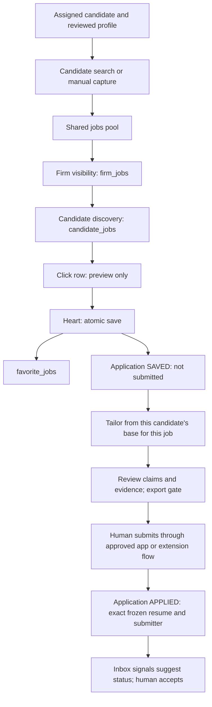

# Candidate jobs → favorites → applications: audit and implementation plan

**Date:** 2026-10-30. **Status:** research and plan only; no implementation authorized by this document.

This records the current source, the user's decisions in this review, and the work needed to connect the candidate Jobs and Applications experience. Source references are repository paths with verified line numbers. Runtime observations belong in §2 and must not be inferred from source. The existing module documents describe earlier integration assumptions; the newer team plan and the decisions below must be reconciled into the owning contracts before implementation.

**Product goal recorded from the user:** make the current localhost:3000 product interface match the intended UI shown at localhost:3001. Treat 3001 as the UI/design reference only; it is not the service to integrate with. Implement the intended workflow in the 3000 product and connect it to its own backend and database.

**Current scope boundary:** prioritize candidate Saved jobs and email Inbox integration. The job-scraping/feed integration is owned by a teammate and comes later; for the first milestone, use clearly labeled mock/demo job records stored in PostgreSQL. Defer the browser-extension-assisted application submission flow and the Applied status automation for a later milestone, after discussing its confirmation and failure cases. Inbox messages can be connected to a candidate in this milestone; automatically moving application statuses based on those messages depends on application/job linkage and is deferred until that contract is agreed.

## 1. Decisions settled in this review

The user explicitly selected the following behavior on 2026-10-29:

1. **Clicking a job row only selects it and previews the job.** It creates no favorite, application, submission, or tailoring run.
2. **Clicking the heart saves that job for this candidate in two places:** a `favorite_jobs` row and an application in **SAVED**. It does **not** mean submitted. Implement this as one atomic, idempotent server operation.
3. **Unheart removes the favorite and an untouched SAVED draft.** Applications that progressed or contain work/history must be preserved. No operation may silently discard notes or tailoring work. The exact untouched predicate and response when work must be retained need a documented contract; the desired preservation policy is settled.
4. **Application form filling is planned through a browser extension.** The extension fills the employer's external application form; the candidate reviews it and clicks Submit. The extension then reports the submission outcome so the dashboard can update. The extension must not submit on the candidate's behalf. Record the source/evidence of the update and retain a manual correction path. A detected click alone may not prove successful submission if the site rejects the form or the request fails; define the confirmation signal before setting Applied.

These are product instructions from this review, not claims about current behavior. They supersede using the current per-user `JobMark.SAVED` as the candidate favorite. They also require a staged application rule: a SAVED draft may exist **before a tailored resume exists**, whereas actual submission must use a tailored resume. The older team instruction says application creation takes a tailored resume; update its wording to distinguish draft creation from submission. Sources: [team application requirements](../team/samad.md#L31), [fixed application columns](../team/00-candidate-core.md#L82), [old personal-mark contract](../02-DATA-CONTRACTS.md#L1006).

Recommended vocabulary: the heart is **Save for candidate** / **Remove from saved**, Applications **Saved** means queued work, and **Applied** means a human confirmed submission. An application board card in Saved must not imply an email was sent or an external form submitted. Current frontend statuses already distinguish `SAVED` and `APPLIED`, and submission counts exclude `SAVED`: [enums.ts:85](../../src/lib/schemas/enums.ts#L85), [candidate-stats.ts:15](../../src/lib/derive/candidate-stats.ts#L15).

## 2. Runtime comparison and database evidence

Read-only observations from the review on 2026-10-30. The current 3000 screen was viewed in the in-app browser; the 3001 reference and Adminer were viewed in Chrome. Database tables were reloaded before checking rows. No inserts, updates, or deletes were made. No sensitive candidate contact details are recorded here.

| Surface | Evidence to insert/confirm | Interpretation boundary |
|---|---|---|
| `localhost:3000`, current candidate Jobs | Signed in as Owner “adnan” for Adnan staffing; candidate `e29e26b3-132e-48c8-b577-00031f9b3416`; Jobs tab shows 0 shown, no matching jobs, and zero summary counts. Split list/preview layout with search, source/work-mode/score filters. URL: `/adnan-staffing/candidates/e29e26b3-132e-48c8-b577-00031f9b3416?tab=jobs`. | Empty UI alone does not prove which database/source is empty. Here source inspection confirms the frontend feed is mock-backed. |
| `localhost:3001`, UI-only design | Candidate `cand_01` is Rajesh Venkataraman. Jobs design shows 15 rows; selecting Cigna changes preview to “2 of 15” while application counts remain stable. Applications design shows Saved and separate workflow columns. | Treat as a visual/interaction reference, not a backend or persistence service. The records are sample design content, not verified live postings. |
| Adminer, `jobs` | Refreshed table showed **0 rows**. Schema has global posting fields and no `firm_id` or `candidate_id`. | Confirms this inspected database has no global jobs at observation time; verify runtime connection before attributing the screen state to this database. |
| Adminer, `firm_jobs` | **0 rows**. Unique `(firm_id, job_id)`; FKs to firms, jobs, searches (nullable), users (capturer); origin check. | No firm can see a database job through this table in the inspected state. |
| Adminer, `candidate_jobs` | **0 rows**. Unique `(candidate_id, job_id)`; FKs to firms, candidates, jobs and nullable searches; score constrained to 0–100 or null. | No candidate-specific database discovery associations in inspected state. It has no direct FK to `firm_jobs`. |
| Adminer, `favorite_jobs` | **0 rows**. Unique `(candidate_id, job_id)`; FKs to firms, candidates, jobs, users. | Table shape supports candidate favorites, but does not link to candidate_jobs or applications and does not itself implement save behavior. |
| Candidate and fixture cross-check | The current candidate exists in the database under firm `1fd709ee-3c4d-48f9-9d56-95ec96992313`. The firm has no `demo-ids.json` mapping and zero matching jobs among the inspected mock fixtures. | Explains the observed 3000 empty feed: mock jobs are filtered by exact firm, and this current firm has no fixture jobs. Separately, the inspected DB tables are also empty. |
| Network / migration runtime | Source route/adapters were inspected; no browser network log or `alembic_version` result was captured in this review. | Do not claim runtime API calls or that migration 0007 is applied to this exact DB. Confirm both before rollout. |

The source findings below describe this checkout. A browser running an older build can differ; no build/source fingerprint was captured, so the UI/source correspondence is not guaranteed.

## 3. What the current source actually does

### 3.1 Candidate Jobs reads a firm mock feed, then filters in the browser

`useCandidateWorkspace(candidateId)` loads candidate-specific applications, resumes, inbox and documents, but calls **`useJobs({ limit: 300 })` without the candidate ID**. `useJobs` calls the firm-scoped `jobsApi.list`; that adapter unconditionally imports the mock. The mock slices the firm's fixture/captured jobs. There is no current frontend `candidate_jobs` request. Sources: [workspace.ts:28–38](../../src/components/app/candidate/use-candidate-workspace.ts#L28), [use-jobs.ts:9–14](../../src/lib/hooks/use-jobs.ts#L9), [jobs.ts:4–12](../../src/lib/api/jobs.ts#L4), [mock jobs.ts:62–69](../../src/mocks/jobs.ts#L62).

`CandidateJobsTab` passes those jobs and the locked candidate into `JobExplorer`. It does not fetch candidate associations itself: [candidate-jobs-tab.tsx:45–51](../../src/components/app/candidate/candidate-jobs-tab.tsx#L45).

The browser then filters active, canonical, nonhidden jobs; requires the candidate's work authorization in `allowedWorkAuth`; excludes **every job with an application for that candidate, including SAVED**; computes a deterministic title-token score; applies source/work-mode/score/search filters; sorts; and slices to **40** rows for a locked candidate. Thus 300 fetched jobs are not 300 candidate matches, and “shown” is a filtered/capped count. Sources: [job-explorer.tsx:115–146](../../src/components/app/jobs/job-explorer.tsx#L115), [match.ts:33–45](../../src/lib/derive/match.ts#L33).

**Required correction for the chosen heart behavior:** creating SAVED must not immediately make the hearted row disappear through `appliedIds`. Define eligibility as “not submitted/progressed” rather than “has any application,” or retain all candidate jobs with a status indicator. Recommended first behavior: retain Saved rows with a filled heart; exclude progressed/submitted rows from the default discovery view, with their application reachable from Applications. Get the final filter/copy recorded with the visual contract.

### 3.2 Selection, heart, Hide and “Tailor & apply” are separate today

| Current action | Verified implementation | Persistent effect today |
|---|---|---|
| Click row | `setSelectedId(job.id)` and close menu. First row is selected by fallback even before a click. | Local preview selection only. [job-explorer.tsx:144](../../src/components/app/jobs/job-explorer.tsx#L144), [248](../../src/components/app/jobs/job-explorer.tsx#L248). |
| Click heart | Toggle `JobMark` kind `SAVED`; no candidate ID in request. | Personal browser mock mark, **no** `favorite_jobs` or application write. [job-explorer.tsx:148–150](../../src/components/app/jobs/job-explorer.tsx#L148), [270](../../src/components/app/jobs/job-explorer.tsx#L270), [job-marks adapter:5–11](../../src/lib/api/job-marks.ts#L5). |
| Hide/Unhide | Toggle `JobMark` kind `HIDDEN`; hidden rows filtered unless Show hidden enabled; available beside each row and in preview menu. | Personal browser mock mark, not deletion and not candidate-specific. [job-explorer.tsx:109–125](../../src/components/app/jobs/job-explorer.tsx#L109), [152–155](../../src/components/app/jobs/job-explorer.tsx#L152), [273](../../src/components/app/jobs/job-explorer.tsx#L273), [380](../../src/components/app/jobs/job-explorer.tsx#L380). |
| Tailor & apply in preview | Renders a `Button` with no handler/href. | No tailoring or application operation. [job-explorer.tsx:361–364](../../src/components/app/jobs/job-explorer.tsx#L361). |
| Find jobs on candidate | Changes to Jobs tab and starts a local matching animation. | No search creation or scraper run. [candidate page:91–94](../../src/app/[firm]/(app)/(workspace)/candidates/[id]/page.tsx#L91), [job-match-intro.tsx:27–35](../../src/components/app/jobs/job-match-intro.tsx#L27), [59–63](../../src/components/app/jobs/job-match-intro.tsx#L59). |

Personal marks are keyed by firm/user/job/kind and can be both saved and hidden; they survive reload through the browser's `benchq.demo-data` store. This persistence can look like a backend save while Adminer remains unchanged. Sources: [job schema:93–104](../../src/lib/schemas/job.ts#L93), [mock marks:8–40](../../src/mocks/job-marks.ts#L8), [mock storage:4–22](../../src/mocks/db.ts#L4), [28–31](../../src/mocks/db.ts#L28).

The current hook optimistically toggles the mark, rolls back on error and invalidates only personal mark data. It has no application side effect or user-facing error UI in the explorer. Sources: [use-job-marks.ts:22–38](../../src/lib/hooks/use-job-marks.ts#L22), [job-explorer.tsx:107–110](../../src/components/app/jobs/job-explorer.tsx#L107).

**Hide is not settled by the new favorite choice.** Q36 explicitly made Hide personal and excluded it from the ledger. Q53 makes favorites candidate-owned. Keep these concepts separate; do not convert Hide into global `jobs.status='skip'`, delete a candidate association, or quietly invent `favorite_jobs.kind='HIDDEN'`. Decide whether the target UI keeps/removes Hide and, if kept, which approved personal persistence API owns it. Sources: [Q36 and Q53](../07-ROUTES-AND-RBAC.md#L55), [personal contract:1025–1033](../02-DATA-CONTRACTS.md#L1025), [favorite table](../../backend/models/candidates.py#L165).

### 3.3 The new tables exist in source; their feature routes do not

| Table | Meaning and source fields | Actual guarantees in this checkout |
|---|---|---|
| `jobs` | Global deduplicated posting pool: UUID ID, unique `external_id`, company/title/url/source/description/location etc. No `firm_id`. | Global posting identity, not candidate or firm ownership. [db.py:164–179](../../backend/models/db.py#L164). |
| `firm_jobs` | Firm visibility of a shared job, with origin, optional search/capturer. | Unique `(firm_id,job_id)`; job FK cascades; search FK sets null. The API supplies frontend `Job.firmId` through this link. [tenancy.py:299–319](../../backend/models/tenancy.py#L299). |
| `candidate_jobs` | A job found/added for a candidate: firm/candidate/job, optional search, nullable score, found time. | Unique `(candidate_id,job_id)`, score 0–100 or null; individual FKs. [candidates.py:147–162](../../backend/models/candidates.py#L147). |
| `favorite_jobs` | A candidate's shortlist; marker is provenance, not its owner. Survives reassignment. | Unique `(candidate_id,job_id)`; nonnull firm/candidate/job/marker and timestamp; individual FKs. [candidates.py:165–176](../../backend/models/candidates.py#L165), [core plan](../team/00-candidate-core.md#L54). |
| `applications` | Candidate + job + chosen resume + submitter + workflow/status history. | Candidate/resume/submitter columns exist but nullable; partial unique candidate/job index only where candidate is nonnull; old default status is `applied`, and `applied_at` defaults to now. [db.py:314–342](../../backend/models/db.py#L314). |
| `resumes` | One base per candidate, many tailored copies with parent/job. | Nullable candidate for old rows; partial unique base index; parent/job set null on delete. No database rule checks a tailored resume's base/job/candidate correspondence or its immutability after submission. [db.py:494–518](../../backend/models/db.py#L494), [route-owned rule in core plan](../team/00-candidate-core.md#L68). |

Migration `0007_candidate_core.py` defines these additions and is revision 0007 after 0006. It deliberately does not implement feature routes. Source existence does not establish merge state or applied database state: [migration:1–26](../../backend/migrations/versions/0007_candidate_core.py#L1), [team core PR scope](../team/00-candidate-core.md#L156).

A repository-wide symbol search for `CandidateJob`/`FavoriteJob` found definitions, migration declarations and tests/isolation fixtures, but **no route or scraper production writer**. The nearest owning route surfaces are the legacy `routes_jobs.py` and `routes_searches.py`; the candidate routes currently end in profile/create/update/assign operations. Sources: [candidate routes:202 onward](../../backend/api/routes_candidates.py#L202), [jobs list:102](../../backend/api/routes_jobs.py#L102), [search creation:113–125](../../backend/api/routes_searches.py#L113). This is an audit of this checkout, not a claim that no developer has unpublished work elsewhere.

**FK caveat:** independent foreign keys guarantee referenced rows exist. They do not prove that `favorite_jobs.firm_id` equals the candidate's firm, that the marker belongs to the firm, that the job is visible via `firm_jobs`, that an optional search is for the same candidate/firm, or that an application's resume belongs to the same candidate/job. There is no favorite→candidate-job FK. Validate these in the application service; add composite constraints only through owner-approved migrations if desired. Sources: [new models:147–176](../../backend/models/candidates.py#L147), [application columns:318–325](../../backend/models/db.py#L318), [resume columns:499–508](../../backend/models/db.py#L499).

`scoped()` enforces firm filtering only; candidate/team scope must be explicitly added. Reuse the candidate visibility rules: Manager→managed candidates; BDE→assigned candidates; missing/out-of-scope returns 404. Sources: [scoping.py:106–109](../../backend/auth/scoping.py#L106), [candidate visibility:126–142](../../backend/api/routes_candidates.py#L126).

### 3.4 Legacy backend routes must not be mistaken for the target workflow

- `POST /api/applications` accepts title/company/url and optional old fields, **not** candidate/job/resume IDs. It may create a posting, links it to the firm, checks duplicate applications by **firm + job**, then creates a candidate-less application. It does not populate the new candidate/resume/submitter columns. [routes_applications.py:45–53](../../backend/api/routes_applications.py#L45), [299–370](../../backend/api/routes_applications.py#L299).
- `GET /api/applications` filters only firm/status and paginates. Its serializer omits candidate ID, submitter ID and the stored `resume_id`; instead list code selects the latest tailored resume by **job only**. With multiple candidates for one posting, this can select the wrong candidate's resume. Use the application's exact `resume_id` after integration. [routes_applications.py:413–444](../../backend/api/routes_applications.py#L413), [941–975](../../backend/api/routes_applications.py#L941).
- The only accepted status values are lower-case `applied`, `interview`, `offer`, `rejected`; an invalid create status falls back to applied, while patch rejects unsupported values. **Do not send SAVED through this create endpoint**: it could log an applied submission. [routes_applications.py:30](../../backend/api/routes_applications.py#L30), [341](../../backend/api/routes_applications.py#L341), [454–457](../../backend/api/routes_applications.py#L454).
- `PATCH /api/jobs/{job_id}` edits shared `jobs.saved/status/seen`. Setting status applied can create a candidate-less application. This is not candidate favoriting and can affect shared state across firms. [routes_jobs.py:996–1010](../../backend/api/routes_jobs.py#L996), [1040–1053](../../backend/api/routes_jobs.py#L1040).
- `link_job_to_firm` is idempotent for a link already present. The `before_flush` hook automatically links only **new** scraped Job objects; it explicitly leaves existing shared-pool jobs rediscovered by another firm for the Jobs track. Discovery must link both new and existing postings to the correct firm **and** candidate. [tenancy.py:322–347](../../backend/models/tenancy.py#L322).
- Search creation is currently a platform operation and writes `DEFAULT_FIRM_ID`; its request shape lacks candidate ID. Do not point candidate Find jobs at it unchanged. [routes_searches.py:28–52](../../backend/api/routes_searches.py#L28), [113–125](../../backend/api/routes_searches.py#L113), [access.py:186–194](../../backend/auth/access.py#L186).
- Resume CRUD/copy/tailor routes currently do not expose/propagate candidate identity. Copy and tailoring persist new Resume rows without candidate ID; patch has no freeze check. The new columns alone do not make tailoring candidate-safe. [routes_resumes.py:473–508](../../backend/api/routes_resumes.py#L473), [668–676](../../backend/api/routes_resumes.py#L668), [703–712](../../backend/api/routes_resumes.py#L703), [1010–1018](../../backend/api/routes_resumes.py#L1010), [1066–1094](../../backend/api/routes_resumes.py#L1066).
- Tailoring returns a run ID to a firm user, but `GET /api/monitor/run/{run_id}` is classified **platform-only**. A BDE cannot use that route as the module-04 polling recipe proposes. Supply a firm/candidate-scoped read API before wiring real progress. [tailor response:779–798](../../backend/api/routes_resumes.py#L779), [access.py:181](../../backend/auth/access.py#L181).
- Route class `FIRM` checks session/firm/support-view restrictions; it does not itself call the action permission policy or add Manager/BDE record scope. New routes need both `require(...)` and candidate visibility checks. [access.py:236–286](../../backend/auth/access.py#L236), [scoping.py:56–70](../../backend/auth/scoping.py#L56).

### 3.5 The frontend integration is still incomplete

Jobs, job marks, applications and resumes adapters in this checkout are **mock-only**, regardless of a corresponding name in `NEXT_PUBLIC_LIVE_MODULES`; the adapters contain no live branch. Candidates do have a live branch. Do not assume setting `jobs,applications,resumes` makes them live. Sources: [jobs adapter](../../src/lib/api/jobs.ts#L4), [marks adapter](../../src/lib/api/job-marks.ts#L3), [applications adapter](../../src/lib/api/applications.ts#L4), [resumes adapter](../../src/lib/api/resumes.ts#L3), [candidate live branch](../../src/lib/api/candidates.ts#L24), [config.ts:22–30](../../src/lib/api/config.ts#L22).

The applications adapter/hooks have list, detail and status change, **no create or save-queue method**. Status changes persist in the browser mock. Candidate Applications supports board/list, error/loading/empty, and Saved is already a pipeline column. Sources: [applications adapter:7–15](../../src/lib/api/applications.ts#L7), [hooks:39–55](../../src/lib/hooks/use-applications.ts#L39), [mock writes:27–53](../../src/mocks/applications.ts#L27), [Applications tab:20–30](../../src/components/app/candidate/applications/applications-tab.tsx#L20), [pipeline:7–11](../../src/components/app/applications/status-meta.ts#L7).

The preview's Tailor & apply is inert; the studio's current tailoring hook itself animates fixture drafts. Its completion cannot become evidence of a real tailored document or submission. [job-explorer.tsx:363](../../src/components/app/jobs/job-explorer.tsx#L363), [tailor-run.tsx:20–40](../../src/components/app/resume-studio/tailor-run.tsx#L20).

The candidate Jobs tab passes loading/data only, not job/application errors or retry callbacks. A failed query could render an empty “No matching jobs” surface, and `useJobMarks` defaults to no marks while a marks query fails. Introduce explicit error handling as part of the authorized integration/design work. Sources: [candidate page:153–162](../../src/app/[firm]/(app)/(workspace)/candidates/[id]/page.tsx#L153), [tab props:11–20](../../src/components/app/candidate/candidate-jobs-tab.tsx#L11), [marks hook:12–15](../../src/lib/hooks/use-job-marks.ts#L12).

### 3.6 Mixed live/mock IDs and stale module assumptions

Seeded backend UUIDs are mapped back to fixture IDs at the adapter edge; unknown/new UUIDs pass through. Candidate DTO uses this mapping. A new live candidate UUID has no automatic mock application/resume/record joins. This is not fixed by hardcoding a default candidate or manufacturing relations. Sources: [demo-ids.ts:3–14](../../src/lib/api/dto/demo-ids.ts#L3), [candidate mapping:80–84](../../src/lib/api/dto/candidates.ts#L80), [mock application filtering:19–21](../../src/mocks/applications.ts#L19).

Module 02 proposes `allowedWorkAuth: []` and says the work-auth filter will not fire. **The source does the opposite:** `[].includes(candidate.workAuth)` is false, so **all** jobs are filtered out for a candidate. The matching intro and shared ranking helper do the same. Resolve the unknown-work-auth product semantics explicitly before live rollout; do not represent unknown authorization as “all authorized.” Sources: [02-jobs mapping/gaps](./02-jobs.md), [explorer:126](../../src/components/app/jobs/job-explorer.tsx#L126), [intro:32](../../src/components/app/jobs/job-match-intro.tsx#L32), [rank helper:57](../../src/lib/derive/match.ts#L57).

Module 03's configured default candidate/current session submitter and module 04's default-candidate mapping are now historical interim assumptions. They must not be used for the new candidate-owned workflow. Real `candidate_id`, exact `resume_id`, and real submitter/history are required; old nullable rows remain explicitly legacy/unassigned until reconciled. Sources: [module 03 field mapping](./03-applications.md), [module 04 Phase 1](./04-resumes-and-tailoring.md), [team requirements](../team/samad.md#L31).

## 4. Correct end-to-end workflow

1. Candidate searches require candidate context and run only within authorized firm/candidate scope. Search results deduplicate global job data, idempotently link `firm_jobs`, and upsert `candidate_jobs` even when a posting already exists globally. Manual add/capture must choose an explicit candidate association path.
2. Candidate Jobs reads associations for the selected candidate, joins authorized shared postings and returns saved/application state. It must not use the entire firm's jobs as a substitute for candidate discovery.
3. Row selection is read-only. Heart performs one server transaction creating/returning the favorite plus the same candidate/job's SAVED application. The optimistic UI updates Jobs and Applications together and restores both on failure.
4. SAVED has no `applied_at`, no submitter and no mandatory tailored resume. It is planning work. The backend must explicitly avoid existing applied/default-now behavior.
5. Tailoring preserves candidate + base + target job identity; AI drafts stay UNVERIFIED until the human review rules permit export. It can attach a chosen tailored resume to the draft without falsely moving it to Applied.
6. A distinct human-confirmed submission operation validates the candidate/job/resume relation and Truth Guard, stores the exact chosen resume/submitter/submission time, freezes what was sent, and transitions SAVED→APPLIED once. Opening the source, exporting, starting tailoring, or autofilling is not submission.
7. Repeated heart on an existing progressed application adds/returns its favorite without changing status, resume, timestamps or events. Unheart preserves that application/history. Untouched SAVED removal follows §5.3.
8. Mail events attach to the candidate/application; status suggestions require human acceptance. This follows the existing team flow and inbox rule: [FLOWS.md](../team/FLOWS.md#L24), [samad.md:24–29](../team/samad.md#L24), [zuhair.md:38–46](../team/zuhair.md#L38).

## 5. Contracts to write before code

### 5.1 Staged application and DTO contract

Record the settled save/unheart behavior in `docs/02-DATA-CONTRACTS.md`, Q53/team plans and rewritten Tracks 02/03/04. Abdul signs off changes to entities/fields/permissions; table owners sign off their owned behavior. Repository rules require contracts before schema changes: [CONTRIBUTING.md:20–31](../../CONTRIBUTING.md#L20), [table ownership](../team/README.md#L35).

| State | Required values/semantics to document |
|---|---|
| SAVED | `firm_id`, `candidate_id`, `job_id`, draft creation timestamp; `applied_at = null`, `submitted_by_user_id = null`, resume optional until chosen. Event records actor/time of save, not a submission. |
| APPLIED / submitted history | Human confirmation, exact tailored resume belonging to same candidate/job/firm, signed-in submitter, real submission time, immutable sent content and status event. Old legacy rows need a separately documented read policy. |
| Favorited with existing application | Favorite independent from application stage once work/progression exists; heart never resets an application to SAVED. |
| Unfavorited but retained draft/history | Favorite can be absent while a worked draft/progressed application remains; response exposes retained application and reason. |

`ApplicationSchema.submittedByUserId` is currently a required string, although backend submitter is nullable. **Do not fill it with the current user for a never-submitted SAVED draft.** Recommended signed contract: make submitter nullable for unsent drafts and derive the draft actor from its event; add an explicit creator field only if product needs it. Clarify `resumeVersionId` versus backend resume ID using module-04's approved representation, not a fake version ID without agreement. Sources: [application schema:16–29](../../src/lib/schemas/application.ts#L16), [backend columns:322–329](../../backend/models/db.py#L322), [module-04 Phase 0](./04-resumes-and-tailoring.md).

Also document which values count as “submitted” after backward/manual status moves. Current counters use `status !== SAVED`; a real submission history/timestamp should remain authoritative if an application cannot be legally moved back to Saved. Status transitions must be enforced by the backend, including resume requirements for Saved→Applied; dragging a card cannot bypass submission confirmation.

### 5.2 Proposed API surface (names to approve, not existing endpoints)

Use candidate routes under `/api/firms/{firm_id}/candidates/{candidate_id}` or equivalent approved scoped paths. Body actor/firm fields are never trusted; derive actor from session and validate URL firm against the signed-in/viewed firm.

| Proposed operation | Owner | Required behavior |
|---|---|---|
| `GET .../jobs` | Zuhair | Paginated candidate associations + mapped job + favorite/application state; counts reflect full filtered result, stable order. Explicit score source and nullable eligibility. |
| `POST .../searches`, search run/status | Zuhair; Uzair for execution | Candidate-required search configuration and candidate-authorized run/status; persistence independent of UI animation. |
| `POST .../jobs` / candidate capture association | Zuhair | Authorized association/capture, global dedupe, correct firm link, candidate upsert, provenance; do not expose an arbitrary global posting ID. |
| `PUT .../favorite-jobs/{job_id}` | Samad | Transactional favorite + SAVED create/return; preserve progressed app. Return canonical favorite + application + counts/state after commit. |
| `DELETE .../favorite-jobs/{job_id}` | Samad | Remove favorite; remove application only if server proves untouched SAVED. Return removed/retained outcome and canonical application state/reason. |
| `GET .../applications`, detail | Samad | Candidate-filtered, permission-scoped, exact resume link and event data, pagination; no default-candidate fallback. |
| application draft edits / submit / status / notes | Samad | Distinct intent for submission, append history, validate resume/Truth Guard, idempotent retry; no replace-all-notes accident from per-event note. |
| candidate resume list/detail/copy/tailor/update/export | Zuhair | Candidate-safe base/copy/target, real polling, read-only frozen sent content; server export enforcement. |
| candidate/firm run-status read | Zuhair with Uzair | Ordinary authorized firm user reads only runs for their candidate/firm; no access to platform monitor history. |

Every route must be classified in `backend/auth/access.py`, apply the action permission and record scope, register F7 isolation cases, and write the approved business ledger events with candidate ID. A platform support view stays read-only; personal Hide retains its separate approved “not in ledger” rule. Existing route classification fails closed for unclassified routes: [access.py:241–247](../../backend/auth/access.py#L241); shared rules: [team README:67–70](../team/README.md#L67), [core ledger instructions](../team/00-candidate-core.md#L140).

### 5.3 Atomicity, idempotence and safe unheart

**Save algorithm:** authorize candidate and job association first; in one transaction serialize changes for that candidate/job (lock a stable parent row or use an approved lock/upsert strategy), upsert favorite, find candidate/job application, create SAVED if missing, otherwise return existing unchanged. Unique constraints are the final race guard. Handle conflicts by re-reading canonical state; a preflight existence check alone is insufficient. Emit one initial-save event and one business ledger event only on a real change; retries must not inflate history. Preserve creation marker/time unless an explicit provenance policy says otherwise.

**Remove algorithm:** use the same candidate/job serialization as save/submission/draft edits. Remove the favorite. Delete the SAVED application only if the server's agreed predicate is true *at the time of the transaction*. Suggested predicate: still SAVED; never submitted; no resume chosen/tailoring work attributable to the draft; no nonblank notes/cover letter/next action/screening answers; no related emails/interviews/follow-ups; no history beyond the initial save. This predicate must account for every owned dependent table before deletion. A newly added field must not silently escape the guard.

If draft work exists, retain the application and return a clear outcome such as “Removed from favorites; saved draft kept because it contains work.” A dedicated explicit discard flow can be designed separately. If another request submits/progresses/edits while unheart runs, preserve the canonical application and its history. Do not cascade-delete substantive history to satisfy unheart. Reheart on a retained/progressed application returns it, never recreates/reset it.

Whether to delete a minimal initial save event with its disposable draft or retain an append-only ledger record of queue removal should be recorded explicitly. Application-event deletion and immutable business-ledger retention are different policies. Current `applications` has delete behavior for interviews and the new inbox FK sets null, so preserving by default is safer than relying on implicit delete relationships: [application relationship](../../backend/models/db.py#L344), [inbox FK](../../backend/migrations/versions/0007_candidate_core.py#L145).

### 5.4 UI contract and independent Hide decision

- Reuse 3001's reviewed visual composition after explicit design approval; preserve its preview-only row interaction. Design parity is a separate deliverable from backend correctness. Record exact list/preview/toolbar/header differences from browser evidence rather than assuming all source markup matches 3001.
- Heart must name candidate context accessibly and update favorite plus Saved column immediately. Do not count it as a submission or alter the candidate's current working status. Disable/reconcile overlapping heart requests or sequence them so out-of-order responses cannot overwrite final intent.
- Mark query/favorite save failures must be visible with retry/rollback; distinguish first-run empty, filtered empty, search still running, and backend error. Do not render permission/network errors as “No jobs.”
- Decide whether Saved rows remain in discovery; recommended retain with filled heart. Counts in header/list/Applications must identify their scope: displayed page, total candidate jobs, saved drafts, submitted applications. Current intro counts fetched jobs and the explorer counts filtered/capped rows; they are not full-database totals.
- Keep filters/tabs/pagination in the URL with Zod validation; current explorer filters and selection use React state. Preserve keyboard row navigation/select/open, separate heart action, focus after removal, dark/light and mobile behavior. [current state:98–113](../../src/components/app/jobs/job-explorer.tsx#L98), [CLAUDE conventions](../../CLAUDE.md#L115).
- Hide: product must decide retention/removal in the target UI. If kept personal, provide its own persistence and query keys; candidate favorite implementation must not silently import per-user Hide into candidate data.

## 6. Implementation sequence and ownership

This sequence scopes reviewable PRs; it does not authorize changing another owner's tables or starting a later team track early. Current order is Abdul core → Samad inbox/applications/extension and Zuhair candidate record/jobs/tailoring; if candidate favorites must ship before extension, Abdul should explicitly schedule that smaller Samad-owned slice. [team order](../team/README.md#L24), [Samad plan](../team/samad.md#L31), [Zuhair plan](../team/zuhair.md#L27).

| Phase / reviewable result | Work and exit condition | Owner / dependencies |
|---|---|---|
| 0. Approve revised contracts and design | Record this review's settled behavior; staged/null application semantics; untouched predicate; exact API response/errors; eligibility/score semantics; resume-version representation; UI differences; Hide decision. Remove obsolete default-candidate assumptions from 02/03/04. No code before required approvals. | Abdul/product + Samad + Zuhair; parent runtime audit. |
| 1. Verify candidate core baseline | Confirm 0007 merge and actual local/test DB revision/constraints; check existing NULL legacy rows. Never edit an already merged migration. | Abdul; read-only verification first. |
| 2. Candidate discovery backend | Scoped candidate search/capture/list; upsert global job, firm link and candidate association for both new/existing postings; pagination and full-result counts. No save/apply side effects. | Zuhair after candidate profile/record task and baseline. |
| 3. Application draft/status backend | New migration(s) for agreed 10 statuses/history/default/timestamp changes; explicit Saved draft representation; candidate-scoped list/detail/update/submit and policy checks; legacy mapping; exact resume references. Keep legacy route compatibility explicit or retire it safely. | Samad after inbox track; coordinate resume contract with Zuhair. |
| 4. Save/unheart transaction | Favorite + Saved atomic operation; race-safe upsert/delete guard; retries; progressed-app preservation; truthful outcome DTO; candidate ledger. | Samad, owning favorites and applications; reads Zuhair's association API/table. Depends on phase 3 semantics and phase 2 authorization contract. |
| 5. Frontend read integration | Real sample DTOs/mappers for candidate jobs/favorites/applications; adapter-only module switch; candidate/firm query keys; correct identity translation; robust loading/error/empty; compatible seeded IDs or fully real slice. | Track owners; no UI or schema changes until phase 0 signoff. |
| 6. Frontend heart + approved design | Wire heart hook to one operation; coordinate cache snapshots/rollback/invalidation for candidate job rows, favorites, application lists/detail, candidate stats and ledger; preserve preview selection and Saved visibility; adopt reviewed 3001 design. | Samad for queue logic; UI owner approved by Abdul; depends on phases 4–5. |
| 7. Tailor/review/submit | Candidate base and claims, real tailor runs and authorized polling, persistent draft edits, export gate, exact chosen resume; submission freeze and idempotent Saved→Applied action. Remove fake tailoring from live path. | Zuhair resume/claims; Samad submission; Uzair run execution/status infrastructure. |
| 8. Inbox/extension integration | Extension reads candidate favorites and uses candidate submission endpoint; per-user token proposal approved; candidate mailbox matching/status suggestions consume exact application IDs. | Samad, after proposal and existing team order; no external send until explicit human submission. |
| 9. Test/rollout/cleanup | Contract, race, isolation and UI tests below; local seeded slice; enable coordinated live modules; verify same DB, restart build for env changes; remove mocks only for completed slices; update board/docs. | Track owners; Uzair production/failure/load testing; Abdul review/merge. |

Frontend expected edit seams: `src/lib/api/jobs.ts`, a candidate jobs/favorites adapter or approved extension of existing adapters, `dto/jobs.ts`/candidate associations/application DTOs and real sanitized samples; `src/lib/hooks/use-jobs.ts`/candidate favorites hooks/`use-applications.ts`; `src/lib/query/keys.ts`; candidate workspace/tab/explorer/error UI and approved 3001 presentation changes. Change `src/lib/schemas/` only after phase-0 contract signoff. Keep screen→hook→adapter→`http.ts`→proxy boundary. Existing adapters and schemas referenced above identify the seams; future filenames/API paths are proposals.

Backend expected edit seams: Samad owns `applications`, `favorite_jobs`, related routes/services/events; Zuhair owns `searches`, `jobs`, `firm_jobs`, `candidate_jobs`, resumes/claims/evidence and related routes/services; Abdul owns core/tenancy/ledger schema approval; Uzair owns production middleware/scheduling. All use `backend/auth/ledger.py` without taking ledger-table ownership. Source ownership: [team README:35–70](../team/README.md#L35).

Migrations: claim the next available number after checking the actual head; one revision per PR with real downgrade, one linear chain; rebase/renumber collisions; add nullable/default columns where necessary and explicitly migrate/backfill old statuses and timestamps. Do not run a broad `applied`→`SAVED` conversion or assign legacy candidate-less rows to an arbitrary candidate. Small branches start from `main`; no stacked PRs. Sources: [CONTRIBUTING.md:11–17](../../CONTRIBUTING.md#L11), [33–40](../../CONTRIBUTING.md#L33), [team migration rules:62–66](../team/README.md#L62).

## 7. Acceptance criteria and meaningful tests

These are tests to implement/run in the later implementation, **not tests executed in this audit**.

### Behavior and data integrity

- Selecting every row, including first/default preview and Cigna in the design reference, changes only preview/focus/selection. Favorite/application counts and database rows remain identical.
- Heart candidate A/job X creates exactly one favorite and one SAVED draft, correct firm/candidate/job/actor event, null applied time/submitter, optional resume. A reload and another authorized session show the saved state.
- Same job for candidate B has independent favorite/application state; same shared posting for a second firm has correctly isolated links/state. Candidate reassignment preserves candidate favorite/draft/history.
- Repeated save, double-click, timeout/retry and concurrent requests create one favorite/application/initial event, with no duplicate ledger actions. No partial favorite-only/application-only state after a failed transaction.
- Unheart untouched draft removes favorite and disposable SAVED draft. Retry succeeds idempotently. Existing work, unrelated rows and submitted counts are unchanged.
- Unheart a worked SAVED/progressed/closed application removes favorite but preserves application, resume, notes, events, related mailbox/screening/interview/follow-up data and submission metadata. Return the retained reason. Concurrent progression/edit versus unheart cannot delete work.
- Reheart an existing retained/progressed application returns it unchanged; no reset to Saved or duplicate creation. Heart never changes candidate status or sends a message/form.
- Saved→Applied requires human confirmation, eligible exact tailored resume and export gate. Direct status patch/board drag cannot bypass it. Wrong firm/candidate/job/base/version, malformed/unknown IDs, a base resume instead of tailored, and unverified claims are rejected consistently.
- Submitted content remains the exact sent copy after later editing/tailoring; a new tailored copy has a new identity. Application serialization uses stored `resume_id`, not “latest resume for job.”
- Candidate discovery writes correct associations for new jobs and existing global duplicates; repeated search runs are idempotent; foreign candidate/search/marker IDs cannot create inconsistent links. A job outside authorized firm/candidate visibility is indistinguishable from missing.

### Contracts, isolation and frontend integration

- Mapper tests use sanitized real responses for null SAVED fields, every approved status, resume identity/version representation, timestamps (timezone/zone-less), nullable score, unknown authorization, legacy rows and paginated totals. Fail visibly on an unsupported contract; no silent status fallback to Applied.
- Extend the reusable `backend/tests/isolation_cases.py` cases and isolation fixture/snapshots for every new route/table read/write; include Owner, Manager own/other team, BDE assigned/unassigned, Viewer, second firm, platform admin and support view. Test action permissions as well as firm isolation. Existing 0007 constraint tests are only a baseline, not end-to-end route validation: [test_migration_0007.py:55–91](../../backend/tests/test_migration_0007.py#L55).
- Hooks use firm + candidate keys; switching candidate or user cannot reuse another candidate's hearts/Saved cards. A failure rolls back both heart and application cache; success invalidates correct stats/detail/ledger. Test reordered responses and rapid reversal.
- Jobs errors, mark errors and application errors display retry; no-data, filter-empty, pending search, permission rejection and backend stopped are distinct. New candidates with UUIDs work without mock records.
- Verify candidate work-auth unknown handling: the proposed empty-array mapper must not accidentally hide every row or falsely assert eligibility. Verify Saved rows stay visible according to approved filter behavior and score labels identify their actual source.
- UI: match approved 3001 screens at 1440/1024/390, both themes; keyboard row/select/heart/preview/applications journey; correct focus/ARIA; reduced motion; axe; filters and pagination survive navigation. Verify “submitted” counts exclude saved drafts and source/preview never changes them.
- Real tailor progress: ordinary BDE can read only authorized run state; terminal failures/retries/cancel/close resolve; run polling stops at completion; no fake completion or mock AI drafts in live mode.

Run the repository's required `pnpm typecheck`, `pnpm lint`, `pnpm test`, frontend build and Postgres backend suite for implementation PRs; migration model/head checks and relevant isolation suite included. Use the disposable `_test` database, never point pytest at the user's working data. The integration README documents the `_test` restriction and that it clears tables per test: [integration README, “Tests run on Postgres”](./README.md#tests-run-on-postgres).

## 8. Safe test-data plan

**No records were inserted, updated, deleted or reset for this audit.** Do not populate Adminer manually to make a UI look functional.

1. First confirm runtime backend URL/proxy, database/schema/version and active live adapters; source alone cannot establish a running service's database. Never print `.env` secrets. Record read-only counts for `jobs`, `firm_jobs`, `candidate_jobs`, `favorite_jobs`, candidate applications and candidate resumes.
2. After implementation authorization, use a dedicated local/demo fixture firm and anonymized candidate, or the disposable Postgres `_test` database. Use the approved seed/service/API so all links and ledger metadata are created together; avoid raw SQL that bypasses authorization/invariants.
3. Fixture matrix: two firms; Owner/Manager/BDE/Viewer; two teams/candidates; one shared job seen by both firms; one firm-private job; one unseen global job; candidate A/B associations; one untouched Saved, one worked Saved, one Applied, one closed application; base/tailored/mismatched resumes; valid and invalid work-auth/score data. Use fake `.test` addresses and inert example source URLs. Never send email, invoke live scraping/LLM, or install/use extension tokens to create test state without the separate approved integration path.
4. Keep fixtures deterministic and referentially complete: job → firm link → candidate association → favorite + Saved draft → chosen tailored resume → explicit test submission. Seed old candidate-null rows only to verify legacy handling; never attach real legacy rows to a guessed candidate.
5. For visual testing preserve the design reference's representative row count/varied sources without copying private candidate information. Label fixture data clearly. Do not infer live job eligibility or provenance from mock content.
6. Cleanup only data created by the approved test fixture and identified by its IDs; use rollback/throwaway database for automated tests. No whole-volume reset, broad truncate/delete, seed `--reset`, or edits to existing candidates as a convenience. Schema changes remain Alembic-only.

## 9. Remaining decisions and execution gates

The heart and unheart product choices in §1 are **settled**, not questions to ask again. Resolve only these remaining contracts before implementation:

| Decision/gate | Recommendation | Owner |
|---|---|---|
| Exact untouched SAVED predicate and retained-draft response | Conservative server predicate in §5.3; preserve any work/progression; serialize against concurrent edits/submission. | Samad + Abdul; Zuhair supplies tailoring-work checks. |
| Nullable submitter and draft timestamps; draft creator attribution | Null submission fields until actual send; actor in initial save event; explicit creator field only if needed and approved. | Samad + Abdul contract signoff. |
| Canonical resume/version representation and freezing/deletion policy | Exact tailored resume identity; immutable sent content; prevent delete or retain an immutable snapshot if source resume can be removed. Current `ON DELETE SET NULL` alone does not preserve the document. | Zuhair + Samad + Abdul. |
| Hide retained/removed and persistent scope | Keep separate personal Hide only if target UI retains it; do not overload candidate favorite or shared job status. | Abdul/product; implementation owner assigned. |
| Unknown work-auth, provenance/legal-basis and score | Explicit unknown eligibility; truthful score source and nullable score; no made-up authorization/provenance. | Abdul + Zuhair. |
| Saved visibility and count labels | Keep Saved rows selectable/hearted in candidate discovery; submitted counts unchanged; separate Saved count. | Abdul/UI owner. |
| Required favorites timing vs team order | Schedule Samad's small queue backend/UX slice before extension if desired; do not silently move team responsibilities. | Abdul + Samad + Zuhair. |
| Migration applied/merged and other in-flight owners | Verify actual DB version and merged head; coordinate next revision and overlapping route contracts. | Abdul and table owners. |
| Legacy APIs/data | Explicit compatibility/deprecation plan; no candidate-less new saves/submissions through old paths, no guessed backfill. | Samad + Zuhair + Abdul. |

Review deliverables: approved revised contracts; per-owner PR breakdown above; sanitized sample payloads; migrations and race/isolation tests; reviewed visual comparison; complete candidate save→tailor→submit journey; rollback/deployment plan for coordinated live adapters. This audit changes **only this Markdown file** and performs no UI, application-code, API or database changes.
