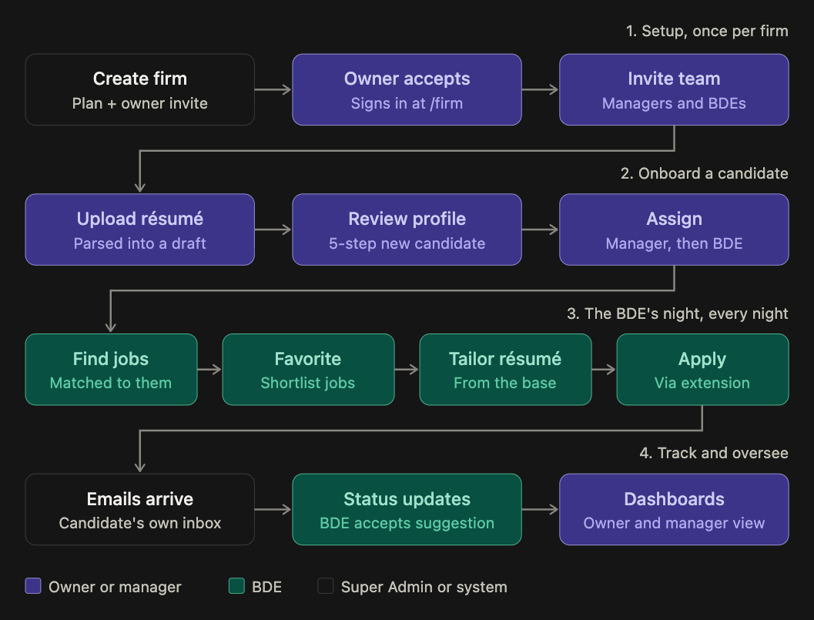
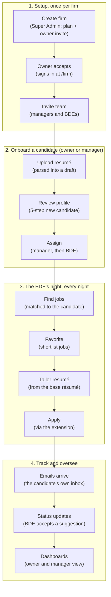
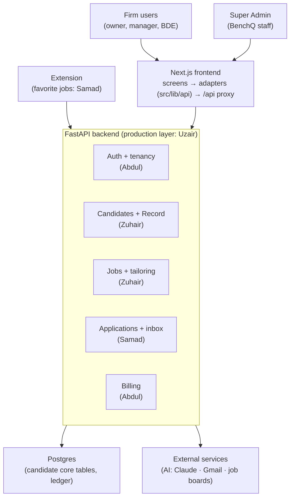

# How BenchQ works: the user flow and the architecture

Two diagrams for the team and for your AI agent (Claude Code, Codex). Each is given as text (Mermaid) so an agent
can read it, with who builds each part. Read with [README.md](./README.md) (owners and rules) and
[00-candidate-core.md](./00-candidate-core.md) (the tables).

## 1. The user flow

Who does each step: **Owner or manager** (purple), **BDE** (green), **Super Admin or the system** (dark).

| Step | Who uses it | Status / who builds it | Tables |
|---|---|---|---|
| Create firm, owner accepts, invite team | Super Admin, Owner | **Built** | `firms`, `users`, `invites` |
| Upload résumé, review profile, assign | Owner, Manager | **Built** (onboarding 01–07); profile and Record improvements: **Zuhair** | `candidates`, `resume_parses`, `claims`, `evidence` |
| Find jobs | BDE | **Zuhair** (job scraping per candidate) | `searches`, `candidate_jobs`, `jobs` |
| Favorite | BDE | **Samad** (with the extension) | `favorite_jobs` |
| Tailor résumé (+ ATS score) | BDE | **Zuhair** | `resumes` (base + tailored) |
| Apply | BDE | **Samad** (applications, then the extension) | `applications` |
| Emails arrive, status updates | BDE | **Samad** (inbox first) | `candidate_mailboxes`, `inbox_messages`, `applications` |
| Dashboards | Owner, Manager | Built on mocks; numbers go live as each track does | derived from the tables above, never stored |
| Every request | Everyone | **Uzair** (rate limits, timeouts, logging, then testing) | — |
| Billing, deployment, clean-up | — | **Abdul** | billing tables (new) |

Rules the flow depends on: a candidate always has a manager and at most one BDE (a candidate without a BDE waits in
the manager's "Needs a BDE" queue); an application uses a **tailored** résumé, frozen once sent; nothing is VERIFIED
without evidence; every row carries `firm_id`, and data never crosses firms.

## 2. The architecture

- The frontend never calls the backend directly from a screen: screens use hooks, hooks call the adapters in
  `src/lib/api/`, adapters call `http.ts`, and `/api/*` is proxied to FastAPI (`next.config.ts`). Each module is
  served by its mock or the backend, switched with `NEXT_PUBLIC_LIVE_MODULES`.
- The backend checks the session and permissions on every route (`backend/auth/access.py`), reads firm data only
  through `scoped()`, and writes every change to the ledger (`backend/auth/ledger.py`).
- AI calls (résumé parsing, tailoring, ATS) happen only in the backend, never in the frontend.
